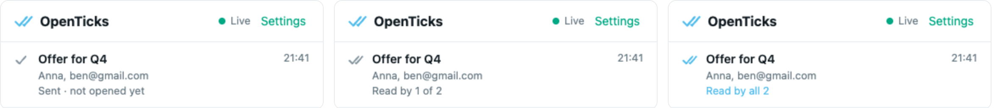

# OpenTicks ✓✓

WhatsApp-style read receipts for your email. Open source and self-hosted, with ticks that update live as people open your mail.

> [!WARNING]
> **Alpha.** The server and extension popup are tested, but the Gmail integration has not been tested against live Gmail yet. Expect rough edges, and please [open an issue](../../issues) if something breaks.



| Tick | Meaning |
|---|---|
| 🕓 | Sending (undo window, scheduled) |
| ✓ grey | Sent, not opened yet |
| ✓✓ grey | Opened by some recipients |
| ✓✓ blue | Read by every recipient |

Ticks appear in your Gmail inbox, in the Sent folder and inside conversations. Hover them to see **who** opened the email and when.

Works with **Gmail** today. Outlook and Proton Mail are on the roadmap ([adding a provider](#adding-a-mail-provider)).

## Setup

You need two things: a small server that receives the tracking pixels, and the browser extension.

### 1. Start the server

Requires [Docker](https://docs.docker.com/get-docker/).

```sh
git clone https://github.com/thomasdallinger/openticks.git && cd openticks

# On a server with a domain pointing at it (HTTPS is set up automatically):
DOMAIN=ticks.example.com docker compose --profile https up -d

# Or just try it on your laptop (prints a temporary https://….trycloudflare.com URL):
docker compose --profile tunnel up
```

Your **access key** is printed in the logs: `docker compose logs openticks`

### 2. Install the extension

1. Download `openticks-…-chrome.zip` from the [latest release](../../releases/latest) and unzip it.
2. Open `chrome://extensions`, turn on **Developer mode**, click **Load unpacked** and pick the unzipped folder.
3. Click the OpenTicks icon in the toolbar and paste your server URL and access key.
4. Reload Gmail. That's it: send an email and watch the ticks.

## Who opened it?

Every email gets a ✓✓ button in the compose window:

- **Track opens** (default): one normal email. Exact for a single recipient. With several recipients, OpenTicks works out who read it from replies and from which mail provider loaded the pixel. Otherwise it shows "opened by someone".
- **Track each recipient**: everyone gets their own copy, so the ticks are exact per person. Recipients don't see each other, and attachments aren't supported yet.
- **Don't track**: sends the email without a pixel.

## How it works

1. When you hit send, the extension adds an invisible 1×1 image to the email and registers it with your server.
2. When a recipient opens the email, their mail app loads the image and your server records the open.
3. The server pushes the update over a WebSocket, and the ticks change instantly without a reload.

**Accuracy notes.** These limits apply to all pixel trackers:
- No ✓✓ if the recipient blocks images. A reply still counts as read.
- Apple Mail Privacy Protection preloads images, so Apple Mail users can show as read right away.
- Your own views in Gmail (with the extension) are ignored. Opening your sent mail in the Gmail mobile app may still count as a read.

## Privacy & legal

Your data stays on your server. Nothing is sent to us or to third parties, and InboxSDK's analytics are disabled. The server stores subjects, recipient addresses and open times. It does **not** store IP addresses. Data is deleted after 180 days (`OPENTICKS_RETENTION_DAYS`).

Read tracking may require recipient consent in your jurisdiction (e.g. under the GDPR/ePrivacy in the EU). Use it responsibly.

## Configuration

Server environment variables (all optional):

| Variable | Default | |
|---|---|---|
| `OPENTICKS_ACCESS_KEY` | generated, stored in `/data` | Key the extension uses to talk to the server |
| `OPENTICKS_RETENTION_DAYS` | `180` | Delete tracked emails after this many days |
| `OPENTICKS_SETTLE_MS` | `4000` | How long an open waits before counting (to filter your own views) |
| `OPENTICKS_MIN_OPEN_DELAY_MS` | `3000` | Ignore opens right after sending (security scanners) |

## Development

Requires [Bun](https://bun.sh) ≥ 1.2.

```sh
bun install
bun run dev:server      # server on http://localhost:8787 (key printed on start)
bun run dev:extension   # opens Chrome with the extension loaded and hot reload
bun test                # unit + integration tests
bun run typecheck
```

```
packages/
  core/        shared types, tick logic, pixel helpers
  server/      Bun + Hono + SQLite, pixel endpoint, REST API, live WebSocket
  extension/   WXT browser extension
    src/lib/              provider-agnostic tracking, live store, ticks
    src/providers/gmail/  Gmail adapter (InboxSDK)
```

### Adding a mail provider

Implement `MailProvider` (`packages/extension/src/providers/types.ts`) next to `providers/gmail/`, then add a content script for the provider's URL. All tracking logic (`prepareTrackedSend`, `reportSelfViews`, `findReplies`, `LiveStore`) is shared, so an adapter only connects the provider's UI events to it.

## License

[MIT](LICENSE)
